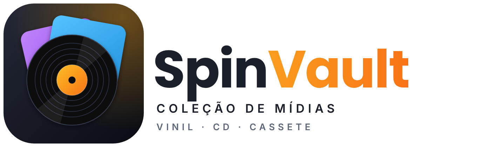
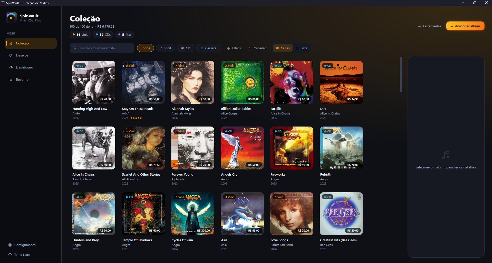
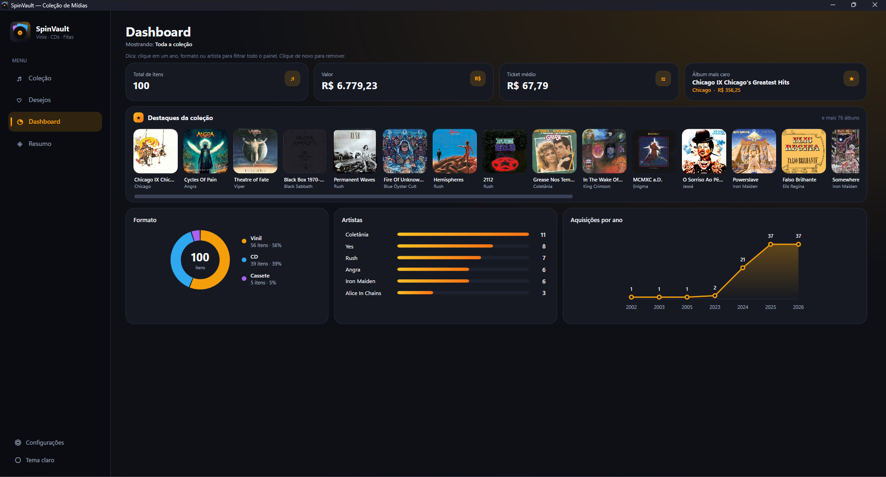

  <picture>
    <source media="(prefers-color-scheme: dark)" srcset="docs/identidade/logo-horizontal-escuro.png">
    
  </picture>

  <b>SpinVault</b> — o catálogo para Windows da sua coleção física de <b>vinis, CDs e fitas cassete</b>.

  
  
  
  

## Sobre

**SpinVault** (*spin* de girar o disco, *vault* de cofre: o lugar onde sua coleção fica guardada) é um aplicativo WPF (C# / .NET 8) que organiza em um só lugar seus discos, com capas, datas de lançamento, valores pagos, lista de desejos e estatísticas. Os dados ficam no seu computador, em um banco SQLite local — sem conta e sem nuvem.

## Capturas de tela

  

Coleção: galeria de capas com busca, filtros por mídia e painel de detalhes.

  

Dashboard interativo: clique em um ano, formato ou artista para filtrar todo o painel.

## Funcionalidades

- Importação de planilha Excel, de CSV e da coleção exportada do **Discogs** (nota, conservação e observações vêm junto).
- Visualização por mídia (vinil, CD, cassete) com busca e filtros.
- Notas pessoais em cada álbum: avaliação de 1 a 5 estrelas, estado de conservação do disco e da capa, onde comprou e observações.
- Gêneros e listas (como "Favoritos" e "Para ouvir"), com filtros por gênero, década e lista.
- **Ordenar e agrupar** a coleção por artista, título, lançamento, valor ou nota, com seções por gênero, década ou artista.
- **Empréstimos**: marque para quem você emprestou um disco, veja há quantos dias ele está fora e filtre os emprestados.
- Capas: download em lote, individual ou colando o link de uma imagem.
- Busca automática de artista e data de lançamento (MusicBrainz e Cover Art Archive, sem chave de API).
- Completar datas de lançamento em lote.
- Lista de desejos separada da coleção.
- Detecção de álbuns duplicados, mesmo em mídias diferentes.
- Dashboard interativo: clique em um ano, formato etc. para filtrar todo o painel.
- Página **Resumo**: quanto você gastou por ano, por mídia e por artista, ranking dos artistas com mais álbuns e "este mês, álbuns que fazem aniversário" (lançados no mês atual, com a lista completa a um clique).
- **Compartilhar**: salve um resumo da coleção como imagem (PNG, formato para redes sociais) ou como relatório em PDF.
- Exportação para Excel (.xlsx) e CSV, com todos os campos (dá para importar de volta).
- Backup e restauração completos (.zip com banco e capas).
- **Backup automático**: de tempos em tempos o app salva uma cópia da coleção na pasta que você escolher (por exemplo, no OneDrive) e mantém só os últimos backups.
- **Aviso de atualização**: o app consulta a Release do GitHub e avisa quando existe uma versão nova (você decide se baixa; nada é instalado sozinho).
- Temas escuro e claro.
- **Dois idiomas: Português (Brasil) e English**, com troca em *Configurações → Idioma / Language* (veja "Idioma").

## Instalação (para quem só quer usar)

1. Abra a página de [**Releases**](../../releases/latest) deste repositório.
2. Em *Assets*, baixe **`SpinVault-Setup-1.2.0.exe`**.
3. Execute o arquivo e siga o assistente (não precisa ser administrador).
4. Abra o **SpinVault** pelo menu Iniciar ou pelo atalho da área de trabalho.

> **Aviso do Windows:** como o instalador não tem assinatura digital paga, o SmartScreen pode mostrar "O Windows protegeu seu computador". Clique em **Mais informações → Executar assim mesmo**.

Prefere não instalar? Baixe também na Release o `SpinVault-portatil-1.2.0.zip`, extraia e execute o `SpinVault.exe`.

Não é preciso instalar o .NET: o aplicativo já vem com tudo que precisa.

Para desinstalar, use *Configurações → Aplicativos*. Sua coleção **não** é apagada (veja "Onde ficam os dados").

## Idioma

O SpinVault fala **Português (Brasil)** e **English**.

- Na primeira vez que você abre o app, ele usa o idioma do Windows (português ou, nos demais casos, inglês).
- Para mudar: abra **Configurações** (menu lateral) e, em **Idioma / Language**, escolha *Português (Brasil)* ou *English*. O app pergunta se pode reiniciar e, ao reabrir, já aparece no novo idioma. A escolha fica salva.
- O idioma muda os textos do app, as datas (25/12/2026 em português, 12/25/2026 em inglês), os valores (R$ 1.234,56 ou R$ 1,234.56), os relatórios em PDF e a imagem de compartilhar, além dos cabeçalhos dos arquivos exportados.
- A coleção não é afetada: você pode trocar de idioma quando quiser. Planilhas e CSV exportados em um idioma podem ser importados no outro, e as datas dos dois formatos são reconhecidas.

## Licença

Defina a licença antes de tornar o repositório público (por exemplo MIT). Sem licença, o código fica com todos os direitos reservados ao autor.

## Créditos

Dados de álbuns: [MusicBrainz](https://musicbrainz.org). Capas: [Cover Art Archive](https://coverartarchive.org).
