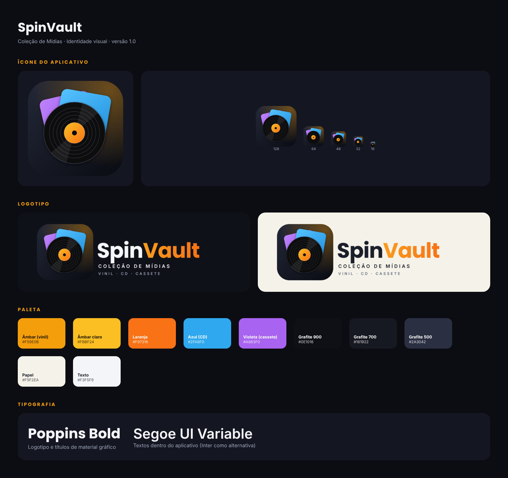

# Identidade visual — SpinVault

## Conceito
Um disco de vinil sobre estojos de CD e fita cassete: os três formatos da coleção em um só símbolo. O rótulo âmbar do disco é o ponto focal e dá nome à cor principal da marca.

## Arquivos
| Arquivo | Uso |
|---|---|
| `Assets/app.ico` | Ícone do executável e da janela (16–256 px) |
| `Assets/logo-128.png` | Logo na barra lateral do app |
| `docs/identidade/icone.svg` / `icone-1024.png` | Ícone em alta resolução |
| `docs/identidade/logo-horizontal-escuro.*` | Logotipo para fundos escuros |
| `docs/identidade/logo-horizontal-claro.*` | Logotipo para fundos claros |

## Paleta
| Nome | Cor |
|---|---|
| Âmbar (vinil) | `#F59E0B` |
| Âmbar claro | `#FBBF24` |
| Laranja | `#F97316` |
| Azul (CD) | `#2FA8F0` |
| Violeta (cassete) | `#A863F0` |
| Grafite 900 / 700 / 500 | `#0E1016` / `#161922` / `#2A3042` |
| Papel | `#F5F2EA` |
| Texto | `#F3F5F9` |

Degradê de destaque: `#FBBF24` → `#F97316`.

## Tipografia
- Logotipo e materiais gráficos: **Poppins Bold**.
- Dentro do aplicativo: Segoe UI Variable (padrão do Windows).

## Boas práticas
- Use a versão escura do logotipo em fundos escuros e a clara em fundos claros.
- Mantenha uma área livre ao redor do logo equivalente à altura do disco central.
- Não distorça, gire nem troque as cores do ícone.
